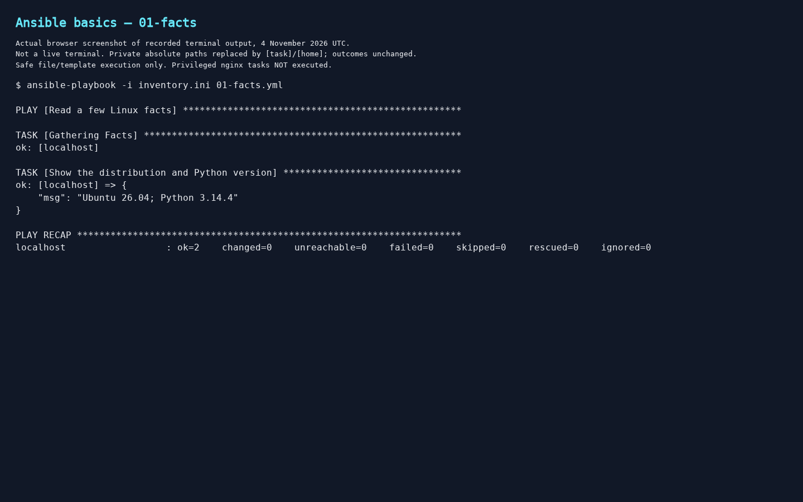
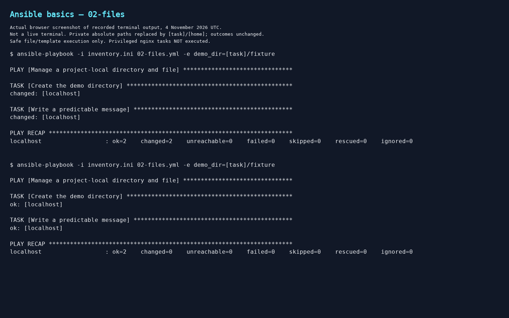
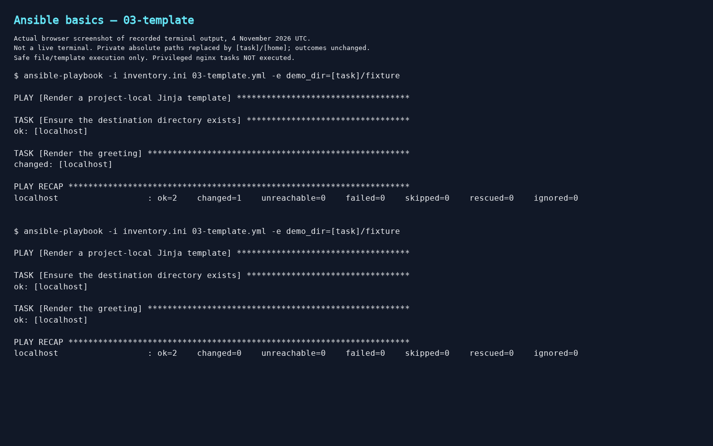
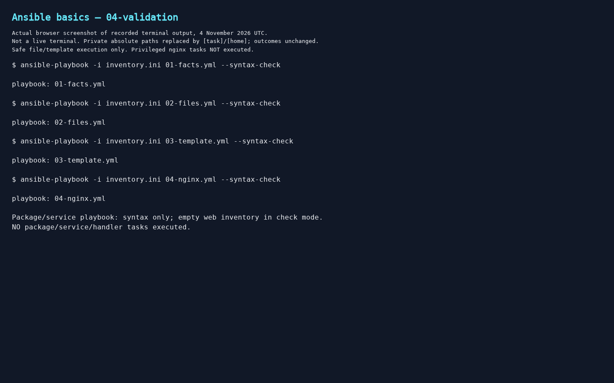

A useful first Ansible playbook does not need to build an entire server. Start by reading a few facts, creating a file and changing its contents predictably. Once those steps make sense, package and service management become easier to follow.

This runnable companion to the [earlier Ansible basics notes](/posts/ansbile-basics/) works through four examples. The first three need no administrator privileges and write only to a dedicated demo directory. The fourth is an optional Debian/Ubuntu web-server example: it makes real system changes and belongs on a disposable VM, not your everyday machine.

## Before you start

The **control node** runs Ansible. A **managed node** is a machine Ansible acts on. For Linux, remote connections normally use SSH, and managed nodes usually need a compatible Python interpreter rather than an Ansible installation. Here, the first three examples use a local connection: your control node is also the managed node. Local does not mean sandboxed.

Install Ansible on the control node using the [official installation guide](https://docs.ansible.com/projects/ansible/latest/installation_guide/intro_installation.html). If you already have pipx installed and its applications on your PATH, the documented minimal option is:

```bash
pipx install ansible-core
ansible --version
```

The examples use built-in modules, so ansible-core is sufficient. Check its [Python support matrix](https://docs.ansible.com/projects/ansible/latest/reference_appendices/release_and_maintenance.html#ansible-core-support-matrix) against your controller and targets.

Get the full [examples directory](https://github.com/Harrison-S1/Harrison-S1.github.io/tree/main/examples/ansible-basics), keeping its filenames and `templates/` subdirectory together. From the repository root, run:

```bash
cd examples/ansible-basics
```

For the exact tested controller dependency versions, use the included `requirements.txt` in a virtual environment as described in the examples README. The pipx command above is the general installation route, not a pinned reproduction. All commands below assume you remain there. The [inventory.ini]({{ '/examples/ansible-basics/inventory.ini' | relative_url }}) identifies the targets:

```ini
[local]
localhost ansible_connection=local

[local:vars]
ansible_python_interpreter=/usr/bin/python3

# Add only a disposable Debian/Ubuntu VM before example 4.
[web]
```

`hosts: local` selects the inventory group, while `ansible_connection=local` avoids SSH. Check that `/usr/bin/python3` exists and is compatible on your machine; adjust the interpreter path if necessary. The empty `web` group is deliberate.

The images below are actual browser screenshots of recorded terminal output, not live terminal screenshots. Private absolute paths are replaced by aliases. For readability, command labels use the familiar `ansible-playbook` form; the recorded tests invoked its Python entry point (`/usr/bin/python3 -m ansible.cli.playbook`) with task-local dependencies. Task output and outcomes are unchanged. The full Jekyll/theme build was not run because Ruby/Bundler was unavailable.

## 1. Read a few Linux facts

Start with [01-facts.yml]({{ '/examples/ansible-basics/01-facts.yml' | relative_url }}):


```yaml
---
- name: Read a few Linux facts
  hosts: local
  gather_facts: true
  tasks:
    - name: Show the distribution and Python version
      ansible.builtin.debug:
        msg: "{{ ansible_facts['distribution'] }} {{ ansible_facts['distribution_version'] }}; Python {{ ansible_facts['python_version'] }}"
```


```bash
ansible-playbook -i inventory.ini 01-facts.yml --syntax-check
ansible-playbook -i inventory.ini 01-facts.yml
```

A play selects hosts and contains tasks. Here, fact gathering collects system information, and `debug` prints selected values. It does not install packages or change configuration. Your distribution and Python version will reflect your machine, not necessarily the test environment.

Use spaces consistently: YAML indentation defines the structure. The longer `ansible.builtin.debug` name identifies the module explicitly.


_Browser screenshot of recorded terminal output, not a live terminal. The local facts run completed without changes; values reflect the test host._

References: [facts](https://docs.ansible.com/projects/ansible/latest/collections/ansible/builtin/setup_module.html) and [debug](https://docs.ansible.com/projects/ansible/latest/collections/ansible/builtin/debug_module.html).

## 2. Create a directory and manage a text file

[02-files.yml]({{ '/examples/ansible-basics/02-files.yml' | relative_url }}) gives Ansible a small desired state to maintain:


```yaml
---
- name: Manage a project-local directory and file
  hosts: local
  gather_facts: false
  vars:
    demo_dir: "{{ playbook_dir }}/sandbox"
  tasks:
    - name: Create the demo directory
      ansible.builtin.file:
        path: "{{ demo_dir }}"
        state: directory
        mode: '0755'
    - name: Write a predictable message
      ansible.builtin.copy:
        dest: "{{ demo_dir }}/hello.txt"
        content: "Hello from Ansible!\n"
        mode: '0644'
```


```bash
ansible-playbook -i inventory.ini 02-files.yml
ansible-playbook -i inventory.ini 02-files.yml
```

`playbook_dir` anchors the destination beside the playbook. The first task creates the parent directory; `copy` then writes the file. Neither task needs `become` because this is a user-owned directory.

Quoted modes avoid YAML number-interpretation surprises. These permissions suit public demo text, not secrets.

Running the same desired state again should not rewrite an already-correct file. That is the useful idea behind **idempotence**. It is not a property you can assume of every task: timestamps, unconditional restarts and changing inputs can produce further changes.

Ansible also owns the specified contents. If you manually edit `hello.txt`, a later run can replace your edit. Start with disposable files, not existing configuration you care about.


_Browser screenshot of recorded terminal output: the fixture’s first run reported changed=2 and its unchanged repeat reported changed=0. Private paths are replaced with aliases; the fixture override differs from the default sandbox directory._

References: [file](https://docs.ansible.com/projects/ansible/latest/collections/ansible/builtin/file_module.html) and [copy](https://docs.ansible.com/projects/ansible/latest/collections/ansible/builtin/copy_module.html).

## 3. Render a Jinja template

Static text works with `copy`. For variable-dependent content, use a separate template. [03-template.yml]({{ '/examples/ansible-basics/03-template.yml' | relative_url }}) includes these variables:


```yaml
  vars:
    demo_dir: "{{ playbook_dir }}/sandbox"
    greeting: Hello from a template
```


It ensures the directory exists, then runs this task:


```yaml
    - name: Render the greeting
      ansible.builtin.template:
        src: greeting.txt.j2
        dest: "{{ demo_dir }}/greeting.txt"
        mode: '0644'
```


The matching [templates/greeting.txt.j2]({{ '/examples/ansible-basics/templates/greeting.txt.j2' | relative_url }}) contains:


```jinja
{{ greeting }}!
Managed for inventory host {{ inventory_hostname }}.
```


These are excerpts; run the complete downloaded playbook, not the fragments individually:

```bash
ansible-playbook -i inventory.ini 03-template.yml
```

Jinja substitutes the greeting and inventory hostname before writing the destination. Change `greeting` in the playbook and rerun it to try a different message. Avoid putting timestamps in a template when you want unchanged inputs to produce unchanged files.


_Browser screenshot of recorded terminal output. Rendering the fixture template reported changed=1; repeating with the same inputs reported changed=0. Private paths are replaced with aliases._

Reference: [template module](https://docs.ansible.com/projects/ansible/latest/collections/ansible/builtin/template_module.html).

## 4. Optional: packages, a service and a handler

[04-nginx.yml]({{ '/examples/ansible-basics/04-nginx.yml' | relative_url }}) combines these ideas on a disposable Debian/Ubuntu VM. It installs nginx, replaces `/var/www/html/index.html`, starts the service and enables it at boot. Installing or starting nginx can expose a network listener: understand the VM's networking first.

This example is **not runtime-tested here**. It requires suitable sudo rights, a functioning service manager and `python3-apt` available to the target interpreter. Its `auto_install_module_deps` option requires ansible-core 2.19 or later. Add only your intended disposable VM to `[web]`, using its actual SSH connection details, before attempting it.

The package task is:

```yaml
    - name: Ensure nginx is installed
      ansible.builtin.apt:
        name: nginx
        state: present
        update_cache: true
        cache_valid_time: 3600
        auto_install_module_deps: false
```

`present` requests installation, not a system-wide upgrade. The cache setting permits refresh when metadata is older than an hour. `apt` is Debian/Ubuntu-specific, not a portable Linux package-manager command. Dependency auto-installation is disabled here; provision the required bindings separately.

The page-template task notifies `Reload nginx`. The complete playbook defines:

```yaml
  handlers:
    - name: Reload nginx
      ansible.builtin.service:
        name: nginx
        state: reloaded
```

A handler normally runs after the tasks section, only when notified by a task reporting a change. Multiple notifications coalesce. Reloading nginx is unnecessary for a static HTML edit; this is a teaching example of notification wiring, not a recommendation to reload after every page update.

Unlike the local examples, this play uses `become: true` for privileged work. If your sudo setup requires a password, `-K` prompts for it; it does not grant permission:

```bash
ansible-playbook -i inventory.ini 04-nginx.yml --syntax-check
ansible-playbook -i inventory.ini 04-nginx.yml -K
```

References: [apt](https://docs.ansible.com/projects/ansible/latest/collections/ansible/builtin/apt_module.html), [service](https://docs.ansible.com/projects/ansible/latest/collections/ansible/builtin/service_module.html) and [handlers](https://docs.ansible.com/projects/ansible/latest/playbook_guide/playbooks_handlers.html).

## Preview changes, then read the results

For public demo data, try:

```bash
ansible-playbook -i inventory.ini 02-files.yml --syntax-check
ansible-playbook -i inventory.ini 02-files.yml --check --diff
```

Syntax checking does not validate the target environment. Check mode predicts changes where supported; it does not guarantee a successful real run. On a fresh destination, a predicted directory is not actually created for the next task. Templates can depend on missing files or earlier results, and handler/service behaviour depends on module support. Some tasks can explicitly run even in check mode.

`--diff` can expose file contents and secrets. Review output before sharing it; do not treat check mode as a security boundary. See the [check/diff guide](https://docs.ansible.com/projects/ansible/latest/playbook_guide/playbooks_checkmode.html).

For this article, recorded tests used ansible-core 2.22.0 with Python 3.14.4. All four playbooks passed syntax checks. Facts ran successfully; file and template tasks ran against a dedicated fixture directory using a `demo_dir` override. Their repeat runs recorded `changed=0`. A separate check/diff run predicted permission corrections on the CIFS fixture filesystem, which reported different modes from those requested. Permissions were not deliberately altered, and permission enforcement was not verified on that filesystem.

Those results cover the local examples in that environment, not every Linux distribution. The nginx check matched no hosts: no package, service or handler task executed, and no Debian target was tested.


_Browser screenshot of recorded syntax-check output. The nginx target group was empty: no package, service or handler task executed. This is not a successful web-server deployment test._

Start with the local examples, read each task and inspect what changed. A small playbook you understand is a better foundation than a large one you are afraid to rerun.
