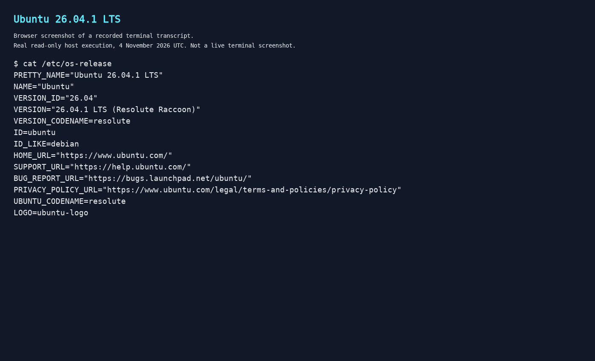
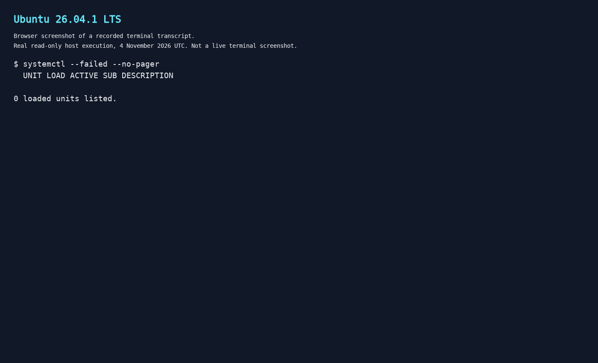
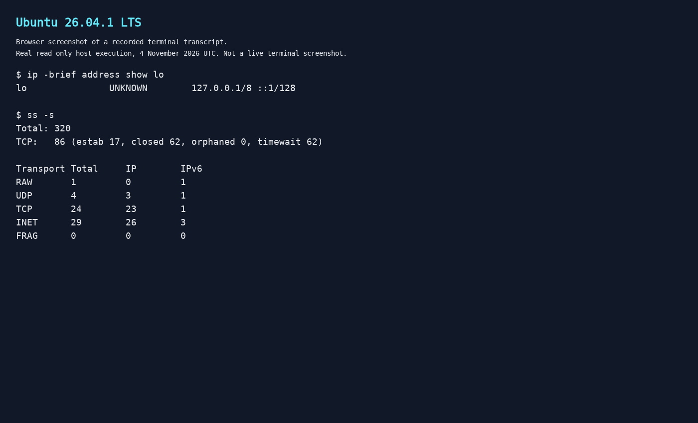
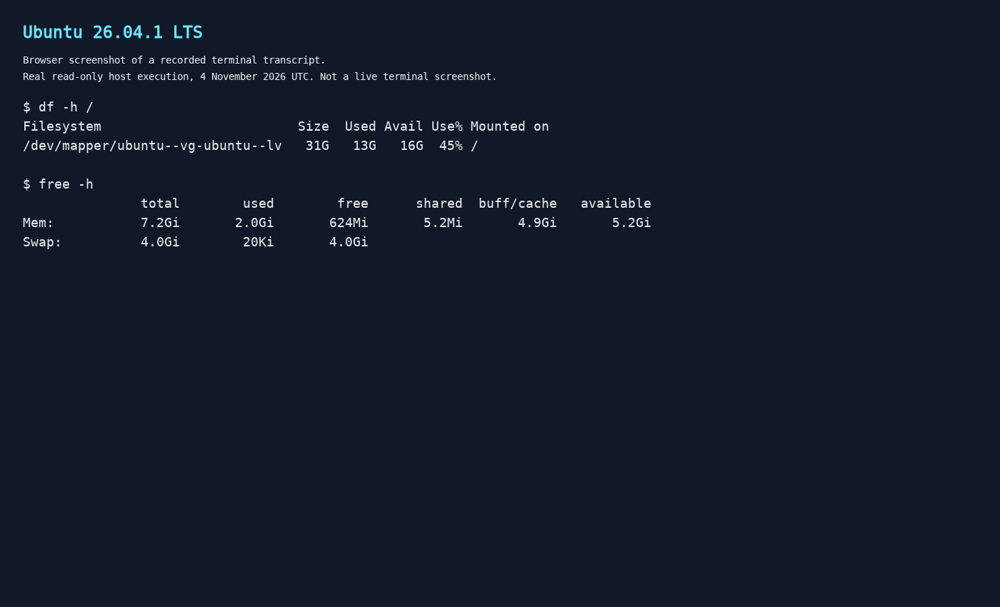

When something looks wrong on a Linux machine, it is tempting to start restarting services or clearing space. A few checks first can save you from changing the wrong thing.

This guide brings together nine useful commands for a first look at an Ubuntu 26.04 LTS system: packages, services, logs, networking, storage and memory. These are established Linux tools, not features newly introduced in 26.04. Ubuntu's [release directory](https://releases.ubuntu.com/26.04/) identifies the current point release as Ubuntu 26.04.1 LTS, Resolute Raccoon.

The examples inspect state rather than install software, restart services or change configuration. Start without `sudo`; permissions and tool availability vary, particularly in minimal images and containers. Read-only does not mean cost-free: scanning a large directory still generates I/O.

The command variants below were smoke-tested on an Ubuntu 26.04.1 LTS host. For `du`, a small dedicated fixture directory was used instead of scanning the real home directory; a successful invocation is not proof that any particular system is healthy. Before sharing output, check it for private addresses, usernames, paths and log content.

The images are actual browser screenshots of preserved terminal transcripts from that host, not live terminal screenshots. Their command output was recorded without fabrication. Network captures deliberately use loopback and aggregate socket counts to avoid exposing private addresses.


_Browser screenshot of the recorded `cat /etc/os-release` transcript; not a live terminal screenshot._

## 1. Check available package upgrades with apt

```bash
apt list --upgradable
```

Use this to see which installed Debian packages have newer candidate versions in the local repository metadata. It lists candidates; it does not install anything.

The important limitation is freshness. If the package indexes are old, this view is old too. Refreshing them with `apt update` is a separate operation that changes local metadata, so it is not part of this inspection checklist.

This is not a list of Snap updates, nor a promise that a later upgrade will install every listed package. APT is intended for interactive use; avoid building scripts around its human-readable output.

Sources: [Ubuntu tutorial using this command](https://ubuntu.com/pro-client/docs/en/latest/tutorials/security-with-pro/) and the [APT manual](https://manpages.ubuntu.com/manpages/resolute/man8/apt.8.html).

## 2. Find failed units with systemctl

```bash
systemctl --failed --no-pager
```

This gives you a starting point when a service has not come up properly. It lists units currently recorded as failed by the system manager. Units include more than services, so read the unit name and description before deciding what to investigate.

For units managed by your own user session, use:

```bash
systemctl --user --failed --no-pager
```

An empty failed-unit list is useful information, but it does not prove every application is healthy. These commands also need an accessible systemd manager; do not assume they will work inside a minimal container.


_Browser screenshot of the recorded `systemctl --failed --no-pager` transcript. Zero failed units is not an application health check._

Reference: [systemctl manual](https://manpages.ubuntu.com/manpages/resolute/man1/systemctl.1.html).

## 3. Read a manageable slice of the journal

```bash
journalctl -b -n 100 --no-pager
```

Rather than opening an unbounded stream of logs, start with up to the latest 100 accessible entries from the current boot. The `-b` option selects that boot, while `--no-pager` prints directly to the terminal.

Once you have a unit to investigate, narrow the query:

```bash
journalctl -b -u ssh.service -n 100 --no-pager
```

Here, `ssh.service` is an example, not an assumption that an SSH server is installed. Replace it with the actual unit name.

Journal visibility depends on permissions. Missing entries may reflect access restrictions or retention, rather than an event never happening. Logs can also contain sensitive information: review them before posting them publicly.

Reference: [journalctl manual](https://manpages.ubuntu.com/manpages/resolute/man1/journalctl.1.html).

## 4. Inspect local sockets with ss

```bash
ss -lntu
```

This shows the local listening TCP and UDP socket view using numeric addresses and ports. The options select listening sockets (`-l`), numeric output (`-n`), TCP (`-t`) and UDP (`-u`). UDP does not use TCP's connection handshake, so do not interpret both protocols identically.

Add `-p` if you need owning-process information:

```bash
ss -lntup
```

Process details may be incomplete without sufficient permissions. More importantly, a local socket listing is not a firewall test or a remote port scan. Finding a listener does not establish that another machine can reach it.

Reference: [ss manual](https://manpages.ubuntu.com/manpages/resolute/man8/ss.8.html).

## 5. Get a concise address overview with ip

```bash
ip -br address show
```

The brief format makes interface names, state and configured addresses easier to scan. It avoids assuming that your interface has a particular name, such as `eth0`.

If the addresses look right but routing is in question, inspect the route table:

```bash
ip route show
```

Both commands describe the current network namespace. An assigned address does not prove that DNS works, that internet access is available or that an application is reachable. Treat this as one layer of the investigation, not a complete connectivity verdict.


_Browser screenshot of recorded `ip -brief address show lo` and `ss -s` transcripts. These privacy-limited variants show only loopback addresses and aggregate counts, not the full address or listener listings above._

Reference: [ip manual](https://manpages.ubuntu.com/manpages/resolute/man8/ip.8.html).

## 6. Understand the storage layout with lsblk

```bash
lsblk -o NAME,SIZE,TYPE,FSTYPE,MOUNTPOINTS
```

Before investigating a full filesystem, establish which devices and mount points you are looking at. These explicit columns show device names, sizes, types, filesystem types and mount points without relying on the default column selection.

This lists storage; it does not mount, format or repair it. Mapped devices and more complex storage arrangements also mean that one device does not always correspond neatly to one filesystem.

Do not confuse device size with available filesystem space. For that, use the next command. Information can also lag immediately after device changes.

Reference: [lsblk manual](https://manpages.ubuntu.com/manpages/resolute/man8/lsblk.8.html).

## 7. Check filesystem capacity with df

```bash
df -hT /
```

This reports space usage and filesystem type for the filesystem containing `/`. Human-readable sizes make it easier to spot capacity pressure. Substitute another existing path when investigating a different filesystem.

If file creation fails despite apparently available space, check inode usage too:

```bash
df -i /
```

Running out of inodes can prevent new files even when byte capacity remains. Neither view tells you which directory is responsible, and neither is a hardware-health check. `df` reports filesystem-wide information; use `du` to investigate directory usage.

Reference: [df manual](https://manpages.ubuntu.com/manpages/resolute/man1/df.1.html).

## 8. Locate directory usage with du

```bash
du -xh --max-depth=1 "$HOME"
```

This reports your home directory's total and totals for its immediate child directories. `-x` keeps traversal on the same filesystem, while quoting `$HOME` handles spaces safely. Unlike a `*` glob, this approach does not omit hidden top-level directories.

The depth limit controls which totals are printed, not how much recursive scanning is required. A large home directory can still take time and generate substantial disk I/O.

Keep permission errors visible: inaccessible directories can make totals incomplete. Do not expect `du` and `df` to match automatically; they answer different questions about storage usage.

Reference: [du manual](https://manpages.ubuntu.com/manpages/resolute/man1/du.1.html).

## 9. Read memory usage with free

```bash
free -h
```

This displays physical memory, swap and cache information in human-readable units. When judging how much room remains for applications, look at `available`, not just `free`.

Linux uses memory for caches, so a small free figure alone does not establish a memory problem. The available figure estimates how much memory can support new applications without swapping; it is not a guarantee that a particular workload will fit.

A single snapshot also cannot explain a performance incident. Use it to decide whether memory needs closer investigation, rather than treating cache clearing as a routine fix.


_Browser screenshot of recorded `df -h /` and `free -h` transcripts. The disk screenshot omits the filesystem-type column requested by `df -hT /` above._

Reference: [upstream free manual](https://man7.org/linux/man-pages/man1/free.1.html).

## Inspect first, change second

You do not need to run every command for every problem. Start with the symptom, narrow the question, and choose the check that answers it. Knowing what each result cannot tell you is just as useful as knowing the command itself.
